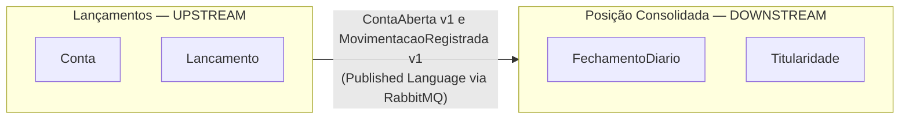

# Modelagem de Domínio (DDD)

Este documento descreve o domínio de **movimentações financeiras e posição consolidada de saldo**. Ele é a referência para a linguagem, os limites entre contextos e as regras de negócio que o código implementa.

> Ao alterar uma regra de negócio, atualize este documento junto com o código.
>
> Os diagramas C4 da solução, com os Bounded Contexts como fronteiras, estão em [ARQUITETURA.md](ARQUITETURA.md).

**Convenção de idioma:** o domínio é tratado em português, tanto na documentação quanto no código (classes, propriedades, métodos, eventos). Nos identificadores de código, os acentos são omitidos (`Lancamento`, `Posicao`). Os termos técnicos de DDD (Bounded Context, Context Map, Upstream, Aggregate Root, Value Object etc.) são mantidos no original em inglês, como são conhecidos na literatura.

---

## 1. Visão geral do problema

O banco precisa de uma solução que:

1. **Registre movimentações financeiras** (créditos e débitos) nas contas dos clientes.
2. **Informe a posição consolidada** (saldo) de um cliente **em um determinado momento**, inclusive no passado.
3. **Continue operando de forma confiável** sob alta demanda, instabilidade ou falhas parciais, sem gerar inconsistências.

As duas primeiras necessidades têm **naturezas diferentes**:

| | Registrar movimentações | Consultar posição consolidada |
|---|---|---|
| Tipo de carga | Escrita | Leitura (volume alto nos picos) |
| Consistência | **Forte**: nada pode se perder ou duplicar | **Eventual** é aceitável (alguns segundos) |
| Impacto de falha | Crítico: dinheiro errado | Alto, mas recuperável (pode ser reconstruído) |

Essa diferença é a base para a separação em dois **Bounded Contexts**.

### Premissas

O enunciado descreve um sistema que registra movimentações e informa o saldo sob demanda, mas não diz quem o utiliza. As premissas abaixo preenchem essa lacuna:

1. **O Cliente é o usuário do sistema.** Ele registra movimentações (créditos, débitos e estornos) e consulta a posição consolidada.
2. **O Cliente só acessa as próprias contas.** Toda operação confere se a conta pertence ao cliente autenticado; o identificador do cliente vem do token JWT, nunca de um parâmetro da requisição. Cada conta guarda o seu **Titular** (`TitularId`), e os dois Bounded Contexts fazem essa verificação (seções [5.6](#56-verificação-de-titularidade) e [6.7](#67-verificação-de-titularidade)).
3. **Os canais de acesso não fazem parte do modelo.** App, internet banking ou qualquer outro canal são apenas meios pelos quais o Cliente chega ao sistema.
4. **Registrar e consultar são permissões separadas.** Os tokens carregam escopos distintos (`lancamentos:escrever` e `posicao:ler`). Hoje o Cliente tem os dois, mas a separação permite, no futuro, dar a um usuário ou sistema apenas o acesso de consulta.

---

## 2. Ubiquitous Language

Os termos abaixo são usados igualmente por negócio, documentação e código. A coluna **Código** indica o nome usado na implementação.

| Termo | Código | Definição |
|---|---|---|
| **Conta** | `Conta` | Conta do cliente que recebe movimentações. Seu significado muda conforme o contexto (ver seção 4). |
| **Titular** | `TitularId` | Cliente dono da conta. Identificado pelo identificador do usuário no Provedor de Identidade (claim `sub` do token), não por dados cadastrais. Cada conta tem um único titular. |
| **Lançamento** | `Lancamento` | Registro **imutável** de uma movimentação. Uma vez registrado, nunca é alterado nem removido. |
| **Crédito** | `TipoLancamento.Credito` | Lançamento de entrada de valor na conta. |
| **Débito** | `TipoLancamento.Debito` | Lançamento de saída de valor da conta. |
| **Estorno** | `TipoLancamento.Estorno` | Lançamento que anula o efeito de outro lançamento. É a única forma de "corrigir" um lançamento. |
| **Valor** | `Valor` | Quantia monetária com moeda. Sempre positiva em um lançamento; o tipo define o sinal. |
| **Saldo disponível** | `SaldoDisponivel` | Saldo atual da conta, usado para autorizar débitos. |
| **Limite** | `Limite` | Quanto a conta pode ficar negativa. Padrão: zero. |
| **Posição consolidada** | `PosicaoConsolidadaResponse` | Saldo de uma conta em um instante específico. |
| **Fechamento diário** | `FechamentoDiario` | Consolidação dos lançamentos de uma conta em um dia (saldo de abertura, créditos, débitos, saldo de fechamento). |
| **Data de competência** | `DataCompetencia` | Momento em que a movimentação efetivamente aconteceu. É a data usada no cálculo da posição. |
| **Data de registro** | `DataRegistro` | Momento em que o sistema gravou o lançamento. Usada para auditoria. |
| **Sequência** | `Sequencia` | Número crescente e sem lacunas dos lançamentos **de uma conta**. Garante ordem e detecta perdas. |
| **Chave de idempotência** | `ChaveIdempotencia` | Identificador enviado pelo cliente para que a mesma solicitação, repetida, produza um único lançamento. |

---

## 3. Subdomains

| Subdomain | Classificação | Justificativa |
|---|---|---|
| **Lançamentos** | **Core** | É o coração do negócio e onde está o maior risco: um erro aqui significa dinheiro errado na conta do cliente. Recebe o maior investimento em modelagem e testes. |
| **Posição consolidada** | **Supporting** | Essencial para o cliente, mas é **derivada** dos lançamentos e pode ser reconstruída a partir deles. |
| **Identidade e acesso** | **Generic** | Problema resolvido pelo mercado. Não é modelado: usa-se autenticação JWT padrão. |

---

## 4. Bounded Contexts

### 4.1 Context Map



- **Relação:** Lançamentos é **Upstream** e Posição Consolidada é **Downstream**.
- **Padrão de integração:** **Published Language**. Lançamentos publica Integration Events versionados, definidos em um projeto de contratos. Nenhum outro código é compartilhado.
- **Sem Shared Kernel:** cada contexto tem o seu próprio modelo, inclusive o seu próprio `Valor`. Compartilhar o domínio acoplaria a evolução dos dois serviços.
- **Cada Bounded Context é um microserviço**, com banco de dados próprio.

### 4.2 Por que "Conta" significa coisas diferentes

| Contexto | O que é uma Conta | Pergunta que ela responde |
|---|---|---|
| Lançamentos | Saldo atual + regras de autorização (situação, limite) | "Posso debitar R$ 100 agora?" |
| Posição Consolidada | Linha do tempo de saldos | "Qual era o saldo em 15/03 às 18h?" |

Um modelo único para as duas perguntas ficaria grande, lento e acoplado. Essa diferença de significado é o principal sinal de que são Bounded Contexts distintos.

---

## 5. Contexto de Lançamentos

**Responsabilidade:** registrar movimentações com garantia de consistência, ser a **fonte da verdade** financeira e publicar o que aconteceu.

### 5.1 Aggregate Root `Conta`

| Atributo | Descrição |
|---|---|
| `Id` | `ContaId` |
| `TitularId` | Cliente dono da conta, definido na abertura |
| `ChaveAbertura` | Chave de idempotência da abertura, única por titular |
| `DataAbertura` | Momento da abertura |
| `SaldoDisponivel` | Saldo disponível atual |
| `Limite` | Limite permitido abaixo de zero. Toda conta nasce com limite **zero**; alterar o limite é uma decisão de crédito do banco, fora do escopo, e nunca vem do cliente |
| `Situacao` | `Ativa`, `Bloqueada`, `Encerrada` |
| `UltimaSequencia` | Última sequência de lançamento emitida |
| `Versao` | Controle de concorrência otimista, como proteção extra ao bloqueio da linha (ver seção 8) |

**Invariantes:**

1. Uma conta que não está `Ativa` não aceita lançamentos.
2. Um débito não pode deixar `SaldoDisponivel` abaixo de `-Limite`.
3. Todo lançamento recebe `Sequencia = UltimaSequencia + 1`, sem lacunas.
4. O saldo disponível só muda por meio de um lançamento: não existe "ajuste de saldo" direto.
5. O `TitularId` é definido na abertura e não muda. Troca de titularidade está fora do escopo.

**Decisão de modelagem: o Aggregate não contém a lista de lançamentos.**
Uma conta pode ter milhões de lançamentos, e carregá-los a cada operação seria inviável. A `Conta` mantém apenas o saldo e a versão, e **produz** um `Lancamento` a cada operação. Ambos são persistidos na **mesma transação**, o que preserva a consistência sem um Aggregate gigante.

### 5.2 Entity `Lancamento`

| Atributo | Descrição |
|---|---|
| `Id` | `LancamentoId` |
| `ContaId` | Conta à qual pertence |
| `Tipo` | `Credito`, `Debito`, `Estorno` |
| `Valor` | `Valor` (sempre positivo) |
| `Descricao` | Texto descritivo, com tamanho limitado |
| `DataCompetencia` | Data de competência |
| `DataRegistro` | Data de registro |
| `Sequencia` | Ordem do lançamento na conta |
| `LancamentoEstornadoId` | Lançamento estornado (somente para `Estorno`) |
| `ChaveIdempotencia` | Chave de idempotência da solicitação |
| `SaldoDisponivelApos` | Saldo disponível da conta logo após este lançamento. Permite que a repetição idempotente devolva exatamente a resposta original e serve à auditoria |

**Regras:**

- É **imutável**: não possui métodos de alteração.
- `DataCompetencia` não pode estar no futuro nem antes do início do dia corrente (UTC). Isso garante que dias já fechados na posição consolidada nunca mudem.
- Um lançamento só pode ser estornado **uma vez**.
- Um estorno não pode ser estornado.
- O estorno aplica o efeito inverso do lançamento original e respeita as mesmas invariantes da conta (estornar um crédito é um débito e pode esbarrar no saldo insuficiente).

### 5.3 Value Objects

| Value Object | Regras |
|---|---|
| `Valor` | Quantia de um lançamento: `decimal` maior que zero, com até 2 casas e no máximo `999.999.999.999,99`, em `BRL`. Imutável e nunca arredondado (`10.005` é recusado). Nunca usa `double`. Saldo e limite não são `Valor`, porque podem ser zero ou negativos. |
| `ContaId`, `LancamentoId` | Identificadores fortemente tipados (GUID v7). Não sequenciais, para não expor volume nem permitir enumeração; a ordenação temporal do v7 mantém os índices do banco eficientes. |
| `TitularId` | Texto opaco vindo do Provedor de Identidade (claim `sub`), obrigatório e com tamanho limitado. O sistema não interpreta o formato: só compara. |
| `ChaveIdempotencia` | Obrigatória, de 1 a 100 caracteres ASCII visíveis; única por conta (lançamentos) ou por titular (abertura). |
| `Descricao` | Obrigatória, até 200 caracteres. |
| `TipoLancamento` | `Credito`, `Debito`, `Estorno`. |

### 5.4 Comandos (casos de uso)

| Comando | Efeito | Falhas de negócio possíveis |
|---|---|---|
| `RegistrarCredito` | Cria um lançamento de crédito | Conta inexistente, conta inativa, valor inválido |
| `RegistrarDebito` | Cria um lançamento de débito | As anteriores + **saldo insuficiente** |
| `EstornarLancamento` | Cria um estorno de um lançamento | Lançamento inexistente, já estornado, saldo insuficiente |
| `AbrirConta` | Cria uma conta `Ativa`, com saldo e limite zero, tendo o cliente autenticado como titular | Nenhuma: repetir a mesma chave devolve a conta já aberta |

Todos os comandos recebem o `TitularId` do cliente autenticado, extraído do token pela camada de API.

Solicitações repetidas com a mesma `ChaveIdempotencia` retornam o **resultado original**, sem criar novo lançamento. A mesma chave com **outro conteúdo** é recusada (`chave-idempotencia-conflitante`). Operações recusadas não ficam registradas: a repetição é reavaliada.

**Códigos de falha.** Cada falha de negócio tem um código estável, devolvido no campo `codigo` das respostas de erro (Problem Details):

| Código | Quando | HTTP |
|---|---|---|
| `conta-nao-encontrada` | Conta inexistente **ou** de outro titular (seção 5.6) | 404 |
| `lancamento-nao-encontrado` | Lançamento a estornar inexistente ou de outra conta | 404 |
| `saldo-insuficiente` | O saldo ficaria abaixo de `-Limite` | 422 |
| `conta-inativa` | A conta não está `Ativa` | 422 |
| `data-competencia-invalida` | Competência no futuro ou antes do início do dia corrente (UTC) | 422 |
| `estorno-nao-estornavel` | Tentativa de estornar um estorno | 422 |
| `lancamento-ja-estornado` | O lançamento já tem estorno | 409 |
| `chave-idempotencia-conflitante` | Chave já usada com outro conteúdo | 409 |
| `valor-invalido`, `descricao-invalida` | Entrada fora das regras dos Value Objects | 400 |
| `chave-idempotencia-obrigatoria`, `chave-idempotencia-invalida` | Cabeçalho `Idempotency-Key` ausente ou fora do formato | 400 |
| `requisicao-invalida` | Corpo malformado ou data sem fuso | 400 |

### 5.5 Eventos

| Domain Event (interno) | Integration Event (público) |
|---|---|
| `ContaAberta` | `ContaAberta v1` |
| `LancamentoRegistrado` | `MovimentacaoRegistrada v1` |
| `LancamentoEstornado` | `MovimentacaoRegistrada v1` (com `tipo = Estorno`) |

Os **Domain Events** são disparados pelo Aggregate e ficam dentro do contexto. Eles são convertidos em **Integration Events** e gravados no **Outbox**, na mesma transação do lançamento. O Delivery Service do MassTransit, dentro da própria `Lancamentos.Api`, publica essas mensagens no RabbitMQ. Assim, o modelo interno pode mudar sem quebrar o contexto Downstream.

`ContaAberta v1` é o primeiro evento de toda conta, com `sequencia = 0`, e é o único que leva o `TitularId` para Posição Consolidada. Os lançamentos começam em `sequencia = 1`.

### 5.6 Verificação de titularidade

Antes de executar qualquer comando, o caso de uso carrega a `Conta` e confere `Conta.PertenceA(titularId)`.

- Se a conta não existe **ou** pertence a outro titular, o resultado é o mesmo: `ContaNaoEncontrada` (HTTP `404`). Responder `403` revelaria que a conta existe.
- A verificação acontece **antes** da checagem da `ChaveIdempotencia`, para que a repetição de uma chave não devolva o resultado de outra pessoa.
- É uma regra de domínio (método da `Conta`), testada como as demais invariantes, e não um filtro só na API.

---

## 6. Contexto de Posição Consolidada

**Responsabilidade:** manter e responder a posição consolidada das contas ao longo do tempo, a partir dos eventos publicados por Lançamentos. É um **modelo de leitura**: não autoriza nem rejeita movimentações.

### 6.1 Aggregate Root `FechamentoDiario`

Identificado por `ContaId` + `Data`.

| Atributo | Descrição |
|---|---|
| `SaldoAbertura` | Saldo no início do dia (fechamento do dia anterior) |
| `TotalCreditos` | Soma dos créditos do dia |
| `TotalDebitos` | Soma dos débitos do dia |
| `SaldoFechamento` | `SaldoAbertura + TotalCreditos - TotalDebitos` |
| `UltimaSequenciaAplicada` | Última sequência de lançamento aplicada |

Só existe fechamento para os dias (UTC) que tiveram movimento. O `SaldoAbertura` de um dia é o `SaldoFechamento` do último dia anterior com movimento, ou zero.

**Invariantes:**

1. Cada lançamento é aplicado **uma única vez**: uma sequência já aplicada é ignorada (idempotência, já que a entrega de mensagens é do tipo "pelo menos uma vez").
2. Lançamentos são aplicados **em ordem**: uma lacuna na sequência deixa o evento pendente até o lançamento faltante chegar.
3. `SaldoFechamento` é sempre consistente com abertura, créditos e débitos.
4. Ao longo da sequência de uma conta, o dia de competência **nunca diminui**, porque Lançamentos só aceita competência no dia corrente. Um movimento com competência antes do último fechamento interrompe a aplicação (`competencia-fora-de-ordem`) em vez de alterar um dia já fechado.

A aplicação é feita pelo Domain Service `ProjecaoDaConta`, que recebe os movimentos pendentes da conta e os aplica enquanto a sequência for a próxima esperada.

### 6.2 Movimentos projetados

Além dos fechamentos diários, o contexto guarda a **titularidade** de cada conta (`Titularidade`: `ContaId`, `TitularId` e `DataAbertura`), criada a partir de `ContaAberta v1`. Uma movimentação de uma conta cuja titularidade ainda não chegou fica **pendente**, pela mesma regra de lacuna na sequência (a abertura é a sequência 0).

A `Titularidade` também guarda o estado da projeção da conta: `UltimaSequenciaAplicada` e `AtualizadoAte` (instante de registro da última movimentação aplicada; antes da primeira, o da abertura). Esse estado fica nela, e não no fechamento, porque existe antes do primeiro fechamento.

O contexto também guarda uma cópia de leitura de cada lançamento recebido (`Movimento`: conta, sequência, `LancamentoId`, tipo, valor, `DataCompetencia`, `DataRegistro`, `LancamentoEstornadoId` e `Efeito`). Ela é necessária para calcular a posição em um instante **dentro** de um dia, e não apenas no fim dele. Todo evento recebido vira primeiro um `Movimento`; **pendente** é o `Movimento` com sequência acima da última aplicada.

O `Efeito` (crédito ou débito) é definido na aplicação. O de um **estorno** é o inverso do lançamento que ele anula: o estorno de um débito soma aos créditos do dia, e o de um crédito, aos débitos. O original sempre tem sequência menor, então já foi aplicado quando o estorno chega a vez.

### 6.3 Cálculo da posição em um instante

```
Posição(conta, T) = SaldoFechamento do último dia fechado antes de T
                  + Σ movimentos com DataCompetencia entre o início do dia de T e T
```

- Dias fechados são **imutáveis** e podem ser mantidos em cache indefinidamente.
- Toda resposta informa até qual sequência e instante a posição está atualizada (`atualizadoAte`: a `UltimaSequenciaAplicada` e o `AtualizadoAte` da `Titularidade`), deixando explícita a consistência eventual. Movimentos pendentes não entram no saldo.
- O saldo de abertura de um dia só vai para o cache quando é **definitivo**: quando a conta já tem movimento aplicado nesse dia ou depois. Pela invariante 4 da seção 6.1, nenhum movimento futuro o altera.

### 6.4 Value Objects

`Valor` e `ContaId` próprios deste contexto (mesmas regras, código independente), e `DataFechamento` (data em UTC).

### 6.5 Consultas

| Consulta | Retorno |
|---|---|
| `ObterPosicaoEm(titularId, contaId, instante)` | Posição no `instante` informado (padrão: agora) e `atualizadoAte` |
| `ObterFechamentosDiarios(titularId, contaId, de, ate)` | Fechamentos diários do período, paginados |

| Código | Quando | HTTP |
|---|---|---|
| `conta-nao-encontrada` | Conta inexistente, de outro titular ou ainda não projetada (seção 6.7) | 404 |
| `instante-invalido` | Instante sem fuso ou no futuro | 400 |
| `periodo-invalido` | Período ausente, invertido, com mais de 366 dias, ou página fora de 1 a 100 itens | 400 |

### 6.6 Reconstrução

Como os lançamentos são imutáveis e ordenados, a posição consolidada pode ser **reconstruída do zero** reprocessando os eventos. Isso torna o contexto recuperável após qualquer falha ou correção de defeito.

Hoje, a reconstrução usa os `Movimento`s já recebidos pela Posição: o comando `reconstruir` do `Posicao.Worker` descarta os fechamentos e reaplica os movimentos de cada conta com o mesmo `ProjecaoDaConta` do consumo. Isso corrige defeitos de cálculo. Recuperar eventos que **nunca chegaram** exige que Lançamentos os reenvie (seção 9).

### 6.7 Verificação de titularidade

Toda consulta confere, pela `Titularidade`, se a conta pertence ao `TitularId` do token. Como em Lançamentos, conta inexistente e conta de outro titular respondem igual (`404`).

Uma conta recém-aberta cuja `ContaAberta v1` ainda não foi processada também responde `404` por alguns instantes. É o efeito visível da consistência eventual, e aparece só na primeira consulta de uma conta nova.

Posição Consolidada **não consulta** Lançamentos para saber o titular: isso criaria uma dependência síncrona entre os contextos, que a arquitetura evita.

### 6.8 Conciliação com Lançamentos

O saldo de cada conta é calculado nos dois contextos: em Lançamentos, para autorizar débitos (`SaldoDisponivel`), e aqui, para a posição. A consistência eventual garante que a Posição alcança Lançamentos, mas não que os dois cálculos concordam. Um defeito no cálculo da projeção, por exemplo, convergiria para o valor errado sem nenhum aviso.

Por isso cada `MovimentacaoRegistrada v1` traz o `saldoDisponivelApos`, o saldo que Lançamentos calculou logo após a movimentação, e o `Movimento` o guarda como `SaldoInformadoApos`. Ao aplicar o movimento, o `ProjecaoDaConta` compara esse valor com o saldo calculado depois da mesma sequência:

1. A comparação é **por sequência**, nunca "no momento atual": o atraso normal da consistência eventual não gera alarme falso.
2. Uma diferença vira uma `Divergencia` (conta, sequência e lançamento), registrada como log de erro com o código `saldo-divergente` e contada na métrica `posicao.conciliacao.divergencias`. Os valores ficam fora do log.
3. A divergência **não bloqueia** a projeção nem altera o saldo calculado: o saldo informado serve só para conferir. A correção continua sendo corrigir o defeito e reconstruir (6.6).
4. A reconstrução concilia de novo, o que permite confirmar a correção.
5. Movimentos recebidos sem o campo (publicados antes dele) são aplicados sem comparação.

Depois de uma divergência, as sequências seguintes da conta também divergem, porque a diferença se propaga no saldo; a primeira sequência apontada indica a origem.

---

## 7. Contrato de integração

Definido no projeto de contratos, versionado e **compatível com versões anteriores**: campos novos são opcionais, e mudanças incompatíveis geram uma nova versão.

**`ContaAberta v1`**

```json
{
  "eventoId": "5e6f7a8b-9c0d-4e1f-a2b3-c4d5e6f7a8b9",
  "tipoEvento": "ContaAberta",
  "versao": 1,
  "contaId": "9b2e4f61-1c7d-4a8e-b3f2-5d6c7e8f9a01",
  "titularId": "auth0|6543a1b2c3d4e5f6a7b8c9d0",
  "sequencia": 0,
  "moeda": "BRL",
  "dataAbertura": "2026-10-27T09:00:00Z",
  "correlacaoId": "b2c3d4e5-f6a7-4b8c-9d0e-1f2a3b4c5d6e"
}
```

**`MovimentacaoRegistrada v1`**

```json
{
  "eventoId": "0f8c1d3e-6a2b-4c55-9b1e-2f4a6d7c8e90",
  "tipoEvento": "MovimentacaoRegistrada",
  "versao": 1,
  "contaId": "9b2e4f61-1c7d-4a8e-b3f2-5d6c7e8f9a01",
  "lancamentoId": "3c4d5e6f-7a8b-4c9d-8e0f-1a2b3c4d5e6f",
  "sequencia": 42,
  "tipo": "Debito",
  "valor": "150.00",
  "moeda": "BRL",
  "dataCompetencia": "2026-10-27T14:32:10Z",
  "dataRegistro": "2026-10-27T14:32:10.512Z",
  "lancamentoEstornadoId": null,
  "saldoDisponivelApos": "350.00",
  "correlacaoId": "a1b2c3d4-e5f6-4a7b-8c9d-0e1f2a3b4c5d"
}
```

O `saldoDisponivelApos` é o saldo disponível da conta logo após a movimentação, usado pela Posição Consolidada para conciliar o saldo que calcula ([6.8](#68-conciliação-com-lançamentos)). É opcional: avisos publicados antes dele não o trazem, e a versão continua a 1.

Valores monetários trafegam como **texto decimal** (`"150.00"`), o padrão do serializador do MassTransit: nenhum consumidor precisa converter para ponto flutuante, o que arredondaria valores grandes em linguagens que só têm `double`. Os contratos aceitam ler número ou texto.

Os eventos **não carregam dados cadastrais** do cliente (nome, CPF, contato), apenas identificadores opacos.

O `TitularId` é um identificador pseudônimo: sozinho não identifica a pessoa, mas pela LGPD dado pseudonimizado continua sendo dado pessoal. Por isso ele trafega **uma única vez**, em `ContaAberta v1`, e não em cada movimentação.

---

## 8. Decisões de modelagem e alternativas

| Decisão | Alternativa considerada | Motivo da escolha |
|---|---|---|
| Lançamentos imutáveis (somente inclusão) com estorno | Permitir edição/exclusão | Auditabilidade e possibilidade de reconstruir qualquer posição. |
| `Conta` sem a coleção de lançamentos | Aggregate contendo todos os lançamentos | Desempenho: o Aggregate continua pequeno, independente do histórico. |
| Bloqueio da linha da `Conta` (`SELECT ... FOR UPDATE`) em cada operação, com `Versao` como proteção extra | Só concorrência otimista, com retentativas | Operações na mesma conta precisam ser serializadas de qualquer forma para o saldo ficar correto. O otimista, sob pico na mesma conta, devolve conflitos ou acumula retentativas; o bloqueio dá um resultado determinístico (sucesso ou falha de negócio) e não afeta contas diferentes. |
| `SaldoDisponivelApos` gravado em cada lançamento | Recalcular o saldo na repetição idempotente | A repetição devolve exatamente a resposta original, e o dado serve à auditoria. Gravado uma vez e nunca alterado. |
| Saldo disponível mantido em Lançamentos | Consultar Posição Consolidada para autorizar débitos | Evita acoplamento síncrono: a autorização não pode depender de outro serviço nem de um dado eventualmente consistente. |
| Dois Bounded Contexts | Um único modelo | Cargas, consistência e significado de "Conta" diferentes. |
| Published Language, sem Shared Kernel | Biblioteca de domínio compartilhada | Permite evoluir cada contexto de forma independente. |
| Consistência eventual na posição consolidada | Atualização síncrona | Isola falhas: se Posição cair, Lançamentos continua operando. O atraso é exposto via `atualizadoAte`. |
| `Resultado` para falhas de negócio | Exceções | Saldo insuficiente é um resultado esperado, não uma exceção. Exceções ficam para falhas técnicas. |
| `decimal` para dinheiro | `double` / centavos em `long` | Precisão exata, com legibilidade melhor que centavos. |
| MassTransit (Transactional Outbox, Inbox, retentativas e DLQ) sobre RabbitMQ | Outbox, Inbox e publicador escritos à mão; cliente `RabbitMQ.Client` puro | Mecanismos de entrega já testados, com menos código próprio numa parte crítica. A regra de ordem (`Sequencia`) continua no domínio, porque o MassTransit não garante ordem. |
| Entrega do Outbox dentro da `Lancamentos.Api` | Container `Lancamentos.Worker` só para publicar | A requisição já não depende do broker (só grava no banco) e o MassTransit faz o lock entre instâncias. Um container a menos; mover a entrega para um Worker é só configuração. |
| Consumer em `Posicao.Worker` separado da `Posicao.Api` | Consumer hospedado na própria API | Consumo e consultas escalam e falham de forma independente. |
| MassTransit **v8** (Apache 2.0) | v9 (licença comercial), Wolverine, Rebus | Open source e suficiente para o desafio. Em produção, avaliar o custo da licença da v9 ou migrar para uma alternativa. |
| Conciliação por sequência, com o `saldoDisponivelApos` no próprio evento | Rotina periódica comparando os bancos dos dois contextos; evento separado de "saldo conferido" | Detecta a divergência na movimentação que a causou, sem chamada síncrona, sem um contexto ler o banco do outro e sem falsos alarmes da consistência eventual. O saldo no evento não é dado novo para a Posição, que já o calcula. |
| `TitularId` na `Conta` e titularidade projetada em Posição via `ContaAberta v1` | Posição consultar Lançamentos a cada requisição; `titularId` em toda `MovimentacaoRegistrada`; claim com a lista de contas no token | Sem dependência síncrona entre os contextos e com o mínimo de dado pessoal trafegando. Uma lista de contas no token ficaria desatualizada e aumentaria o token. |
| Domínio e código em português | Código em inglês | Mantém a Ubiquitous Language idêntica entre negócio, documentação e código, sem tradução mental. |

---

## 9. Fora do escopo (evoluções futuras)

- **Partidas dobradas** (todo lançamento com contrapartida em outra conta), necessárias para transferências entre contas.
- **Múltiplas moedas** e conversão cambial.
- **Lançamentos futuros/agendados** e retroativos além do dia corrente.
- Contexto de **Clientes** (cadastro, dados pessoais), hoje tratado apenas por identificadores.
- **Reenvio de eventos** por Lançamentos (de uma conta ou de todas), para reconstruir a Posição Consolidada mesmo depois de perder eventos.
