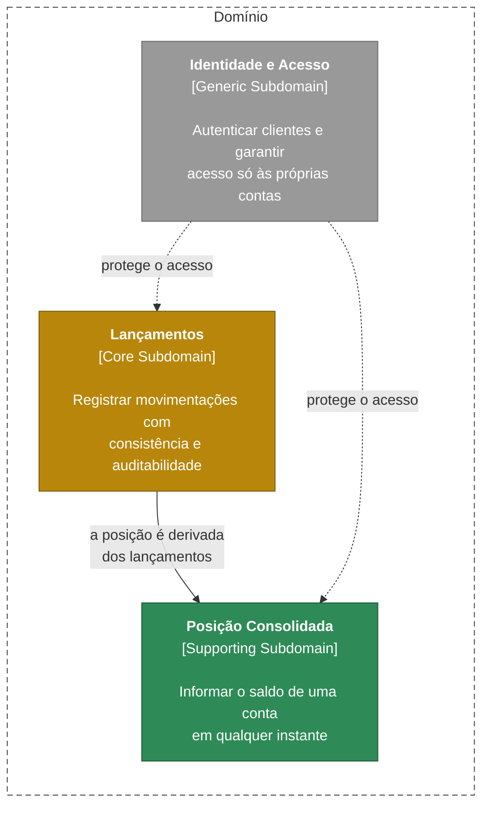

# 1.1 Subdomains

> **DDD Estratégico** · [Índice](../../ARQUITETURA.md) · Próximo: [1.2 Context Map](02-context-map.md)

O domínio de movimentações financeiras se divide em três Subdomains, classificados pela importância para o negócio.

| Subdomain | Classificação | Estratégia |
|---|---|---|
| **Lançamentos** | Core | Maior investimento em modelagem e testes: é onde está o risco financeiro. |
| **Posição Consolidada** | Supporting | Desenvolvido internamente, mas mais simples: é derivado e pode ser reconstruído. |
| **Identidade e Acesso** | Generic | Não é desenvolvido: usa-se um provedor de identidade pronto (JWT). |
