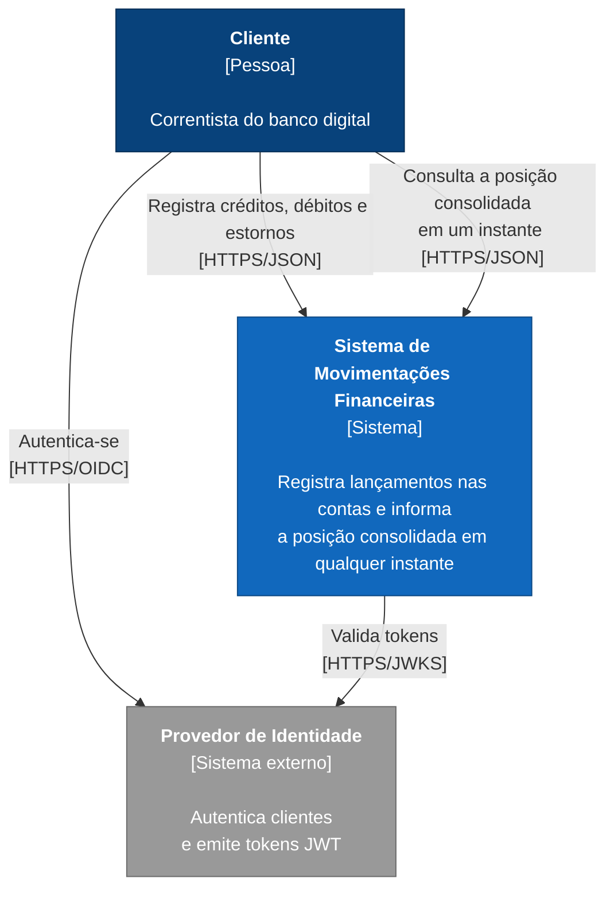

# 1.3 C4 — System Context

> **DDD Estratégico** · [Índice](../../ARQUITETURA.md) · Anterior: [1.2 Context Map](02-context-map.md) · Próximo: [1.4 C4 — Container](04-c4-container.md)

Cores e formas seguem a [legenda dos diagramas C4](../../ARQUITETURA.md#legenda-dos-diagramas-c4).

Quem usa o sistema e com quem ele se relaciona.

| Elemento | Responsabilidade |
|---|---|
| **Cliente** | Registra movimentações e consulta a posição consolidada. Só tem acesso às contas que lhe pertencem. |
| **Provedor de Identidade** | Generic Subdomain: não é desenvolvido aqui, apenas integrado. |

O enunciado não define quais canais o cliente usa (app, internet banking etc.). Por isso o diagrama mostra o Cliente falando diretamente com o sistema: qualquer canal entra como um meio de acesso, sem mudar o modelo. As premissas sobre usuários e acesso estão em [DOMINIO.md](../../DOMINIO.md#premissas).
