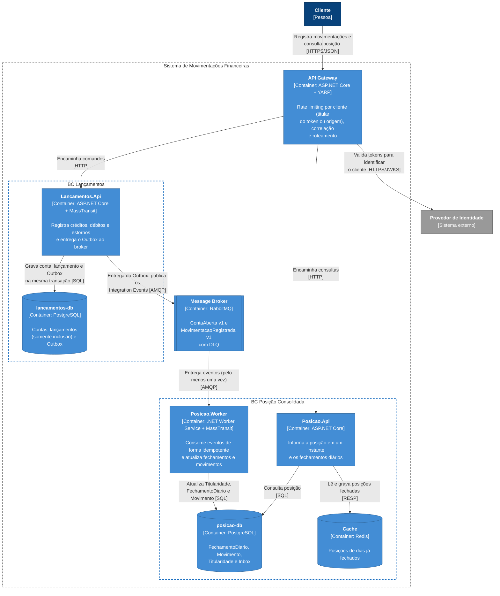

# 1.4 C4 — Container

> **DDD Estratégico** · [Índice](../../ARQUITETURA.md) · Anterior: [1.3 C4 — System Context](03-c4-system-context.md) · Próximo: [2.1 BC Lançamentos — Modelo de domínio](../02-ddd-tatico/01-lancamentos-modelo-de-dominio.md)

Cores e formas seguem a [legenda dos diagramas C4](../../ARQUITETURA.md#legenda-dos-diagramas-c4).

Cada Bounded Context é um microserviço independente, com seu próprio banco de dados: **Lançamentos** (Core, Upstream) e **Posição Consolidada** (Supporting, Downstream). A única ligação entre eles são os eventos `ContaAberta v1` e `MovimentacaoRegistrada v1`, publicados no RabbitMQ (**Published Language**).

| Container | Bounded Context | Por que existe separado |
|---|---|---|
| **API Gateway** | — | Ponto único de entrada: rate limiting por cliente e correlação num só lugar. Ele valida o token só para identificar o cliente; a autorização fica em cada serviço, que valida o token de novo e confere os escopos (as setas dos serviços ao Provedor de Identidade foram omitidas). |
| **Lancamentos.Api** | Lançamentos | Caminho crítico de escrita, com consistência forte. A entrega do Outbox roda dentro dela (Delivery Service do MassTransit): a requisição só grava no banco, então se o broker estiver fora a API continua aceitando lançamentos e as mensagens aguardam no Outbox. |
| **Posicao.Worker** | Posição Consolidada | Hospeda apenas o consumer do MassTransit. Fica separado da API para que consumo e consultas escalem e falhem de forma independente. |
| **Posicao.Api** | Posição Consolidada | Leitura com volume alto nos picos, escalável horizontalmente. |
| **RabbitMQ** | — | Desacopla os contextos: uma falha em Posição Consolidada não afeta o registro de lançamentos. |

Todos os containers de aplicação exportam traces OpenTelemetry (OTLP) para um coletor, que no ambiente local é o Jaeger. Ele fica fora do diagrama por não fazer parte do fluxo de negócio.

### Por que não há um `Lancamentos.Worker`

O Transactional Outbox do MassTransit grava a mensagem na tabela de Outbox dentro da mesma transação do `SaveChanges` e a entrega ao RabbitMQ por um hosted service, com lock no banco para que várias instâncias da API não publiquem a mesma mensagem. Um processo separado só para publicar não traria isolamento adicional. Se a entrega um dia pesar na API, ela pode ser desligada ali e movida para um Worker próprio, mudando apenas a configuração. A decisão está registrada em [DOMINIO.md](../../DOMINIO.md#8-decisões-de-modelagem-e-alternativas).
