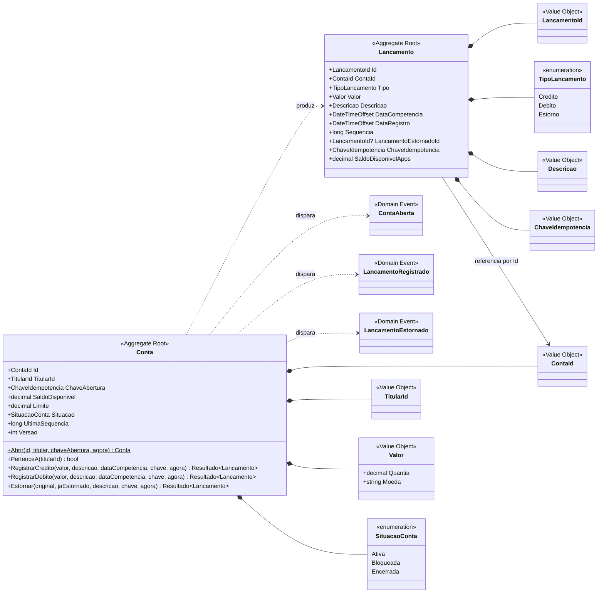

# 2.1 BC Lançamentos — Modelo de domínio

> **DDD Tático** · [Índice](../../ARQUITETURA.md) · Anterior: [1.4 C4 — Container](../01-ddd-estrategico/04-c4-container.md) · Próximo: [2.2 BC Lançamentos — C4 Component](02-lancamentos-c4-component.md)

A `Conta` é o Aggregate Root e a única porta de entrada para criar lançamentos. Ela **produz** um `Lancamento` a cada operação, mas não guarda a coleção de lançamentos: o `Lancamento` é um Aggregate Root próprio, gravado na mesma transação (ver [DOMINIO.md](../../DOMINIO.md), seções 4.3 e 5.1).

| Elemento tático | Papel |
|---|---|
| **Aggregate Root** `Conta` | Protege as invariantes: situação ativa, limite de saldo, sequência sem lacunas e titular fixo. `PertenceA` é a verificação de titularidade. |
| **Aggregate Root** `Lancamento` | Tem identidade própria, Repository próprio e é imutável depois de criado. Só a `Conta` o cria, na mesma transação; referencia a conta só pelo `ContaId`. |
| **Value Objects** | `Valor`, `ContaId`, `TitularId`, `LancamentoId`, `Descricao`, `ChaveIdempotencia`: sem identidade, imutáveis e autovalidados. |
| **Domain Events** | `ContaAberta`, `LancamentoRegistrado` e `LancamentoEstornado`: disparados pela `Conta` e convertidos em Integration Event no Outbox. |
