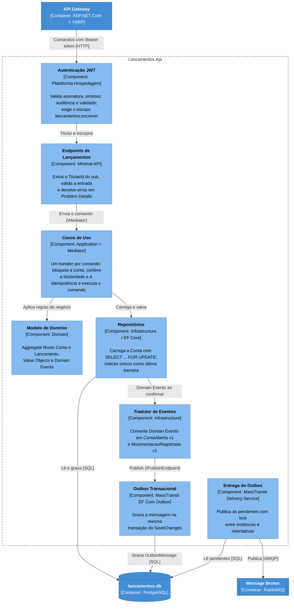

# 2.2 BC Lançamentos — C4 Component

> **DDD Tático** · [Índice](../../ARQUITETURA.md) · Anterior: [2.1 BC Lançamentos — Modelo de domínio](01-lancamentos-modelo-de-dominio.md) · Próximo: [2.3 BC Posição Consolidada — Modelo de domínio](03-posicao-consolidada-modelo-de-dominio.md)

Cores e formas seguem a [legenda dos diagramas C4](../../ARQUITETURA.md#legenda-dos-diagramas-c4).

As dependências apontam sempre para o Modelo de Domínio, que não depende de nenhuma outra camada.

Os componentes **Outbox Transacional** e **Entrega do Outbox** são do MassTransit, apenas configurados (`AddEntityFrameworkOutbox` com `UseBusOutbox`). O código próprio do contexto é o **Tradutor de Eventos**, na Infraestrutura, que mantém o modelo interno separado da Published Language: Domínio e Aplicação não conhecem os contratos, e os testes de arquitetura garantem isso. Os endpoints só conhecem o `IMediator` e os comandos: o Mediator, da biblioteca técnica `Plataforma.Mediator` (compartilhada pelos dois contextos e sem pacote externo), entrega cada comando ao único handler registrado para ele, e um teste de arquitetura impede a borda de usar um handler diretamente. A **Autenticação JWT** vem da biblioteca técnica `Plataforma.Hospedagem`, reaproveitável pelos outros serviços.
