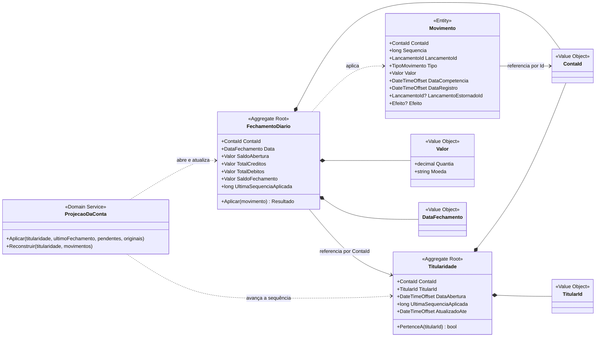

# 2.3 BC Posição Consolidada — Modelo de domínio

> **DDD Tático** · [Índice](../../ARQUITETURA.md) · Anterior: [2.2 BC Lançamentos — C4 Component](02-lancamentos-c4-component.md) · Próximo: [2.4 BC Posição Consolidada — C4 Component](04-posicao-consolidada-c4-component.md)

O `FechamentoDiario` é o Aggregate Root principal deste contexto. Ele é alimentado pelos eventos de Lançamentos e garante que cada movimento seja aplicado uma única vez. A ordem é garantida pelo Domain Service `ProjecaoDaConta`.

| Elemento tático | Papel |
|---|---|
| **Aggregate Root** `FechamentoDiario` | Garante idempotência (sequência já aplicada é ignorada) e mantém os totais do dia consistentes. |
| **Aggregate Root** `Titularidade` | Quem é o titular de cada conta, criada por `ContaAberta v1`. Responde se a conta pertence ao cliente da consulta e guarda a última sequência aplicada e o `AtualizadoAte`. |
| **Entity** `Movimento` | Cópia de leitura de cada lançamento, usada para calcular a posição dentro de um dia. Fica pendente até a sua vez; o `Efeito` (o inverso do original, no estorno) é definido na aplicação. |
| **Domain Service** `ProjecaoDaConta` | Aplica os pendentes em ordem de sequência, parando na primeira lacuna, e abre um fechamento a cada novo dia. A reconstrução usa o mesmo serviço. |
| **Value Objects** `Valor`, `ContaId`, `TitularId`, `DataFechamento` | Próprios deste contexto: não são compartilhados com Lançamentos (sem Shared Kernel). |

O resultado da consulta (saldo em um instante e até quando o dado está atualizado) não é um elemento do domínio: é a resposta `PosicaoConsolidadaResponse`, montada na Application a partir dos fechamentos e movimentos.
