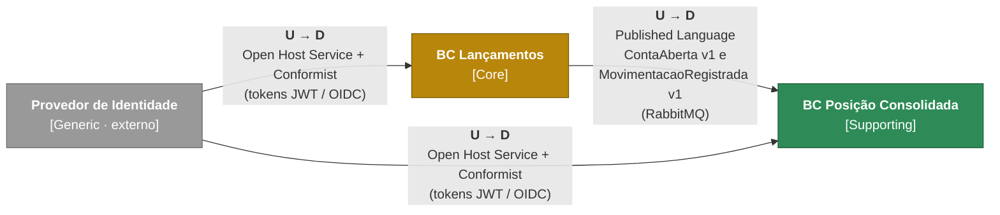

# 1.2 Context Map

> **DDD Estratégico** · [Índice](../../ARQUITETURA.md) · Anterior: [1.1 Subdomains](01-subdomains.md) · Próximo: [1.3 C4 — System Context](03-c4-system-context.md)

Cada Subdomain desenvolvido aqui vira um Bounded Context. O mapa mostra quem depende de quem (**U** = Upstream, quem fornece; **D** = Downstream, quem depende) e como eles se integram.

| Relação | Padrão | Significado |
|---|---|---|
| Lançamentos → Posição Consolidada | **Published Language** | Lançamentos publica um contrato de eventos com versão. Posição Consolidada depende desse contrato, não do modelo interno de Lançamentos. Não há **Shared Kernel** (código de domínio compartilhado). |
| Provedor de Identidade → os dois BCs | **Open Host Service** + **Conformist** | O provedor usa um protocolo padrão (OIDC/JWT), e os BCs o seguem como é. |
