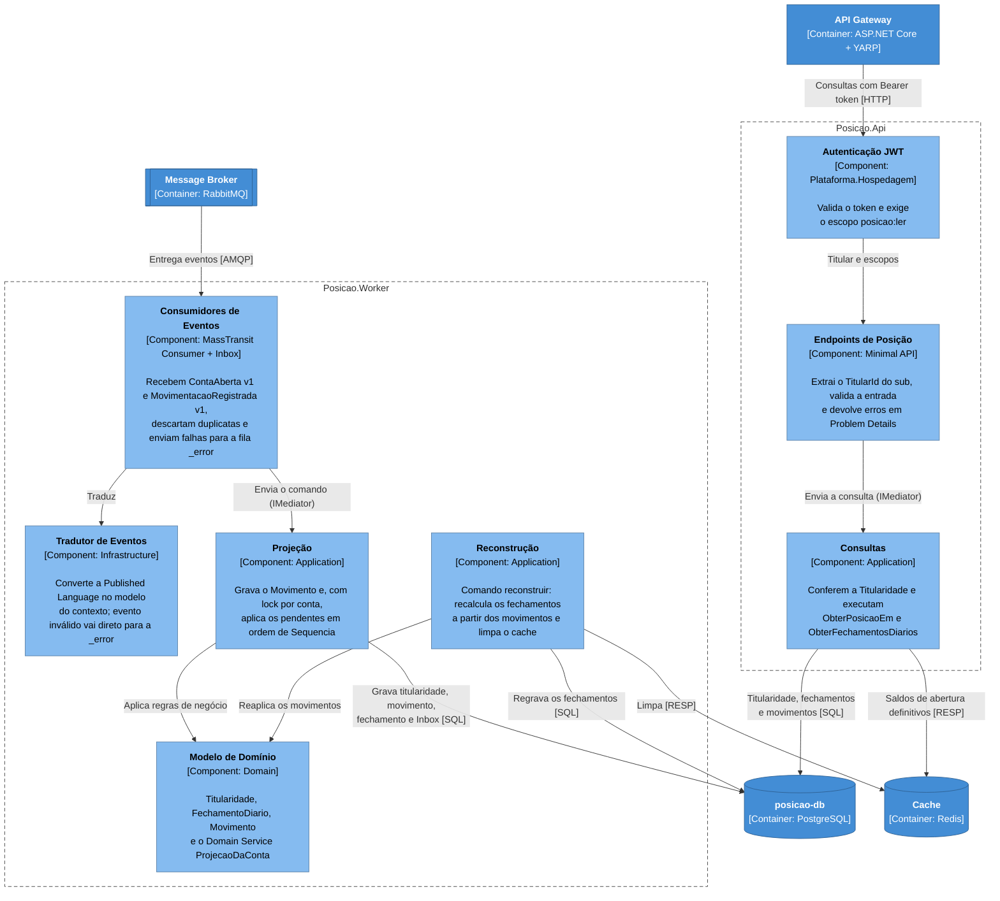

# 2.4 BC Posição Consolidada — C4 Component

> **DDD Tático** · [Índice](../../ARQUITETURA.md) · Anterior: [2.3 BC Posição Consolidada — Modelo de domínio](03-posicao-consolidada-modelo-de-dominio.md) · Próximo: [2.5 Ciclo de vida de um débito](05-ciclo-de-vida-de-um-debito.md)

Cores e formas seguem a [legenda dos diagramas C4](../../ARQUITETURA.md#legenda-dos-diagramas-c4).

O MassTransit cuida da entrega: Inbox (`InboxState`) para não processar o mesmo `eventoId` duas vezes, novas tentativas e fila `_error` como DLQ. Ele **não garante ordem**, então a ordem é regra do domínio:

- A `Titularidade` guarda a última sequência aplicada.
- O `ProjecaoDaConta` aplica os pendentes enquanto a sequência for a próxima esperada e para quando falta uma.
- O `FechamentoDiario` ignora uma sequência já aplicada.
- O lock por conta (`pg_advisory_xact_lock`) faz os eventos da mesma conta correrem um de cada vez, mesmo com várias instâncias do Worker.

Consumidores, endpoints e o comando `reconstruir` só conhecem o `IMediator` e os pedidos; cada comando ou consulta tem um único handler na Application.

O cache é opcional: com o Redis fora do ar, as consultas leem tudo do banco e respondem o mesmo saldo.
