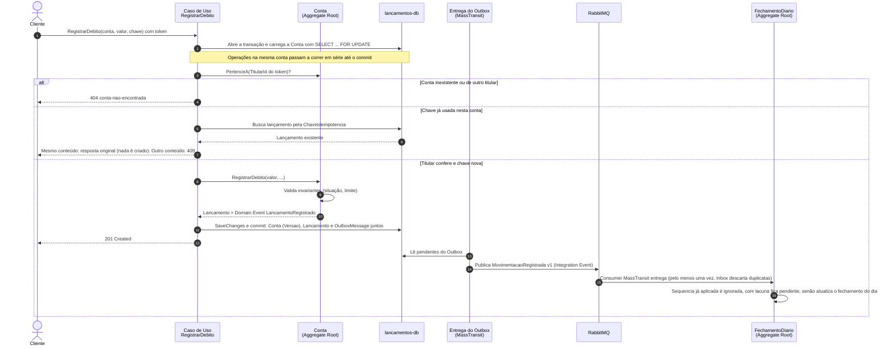

# 2.5 Ciclo de vida de um débito

> **DDD Tático** · [Índice](../../ARQUITETURA.md) · Anterior: [2.4 BC Posição Consolidada — C4 Component](04-posicao-consolidada-c4-component.md)

O caminho de um débito pelos dois Bounded Contexts, do comando até a posição consolidada.

